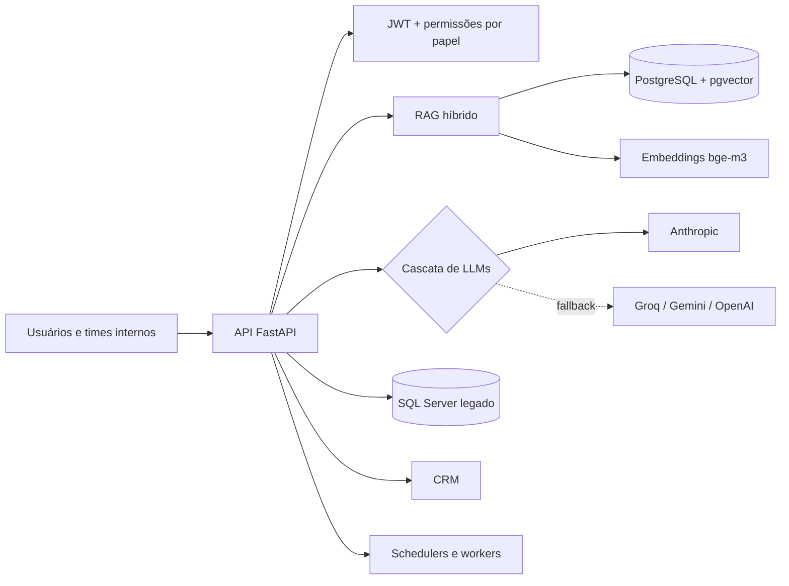

<h1 align="center">Olá, eu sou o Anderson Dittrich 🖖</h1>

  <b>Construo plataformas de IA corporativa e sistemas para cartórios</b> 
  RAG · orquestração de LLMs · APIs em Python · desktop moderno · automação de dados

  
  

---

### 🧠 O que eu construo

Quase tudo que faço vive em repositórios privados, então aqui vai o resumo do que está por trás dos quadradinhos:

- **Plataforma de IA corporativa.** API em FastAPI com RAG híbrido (vetorial + palavra-chave) sobre a base de conhecimento interna, embeddings multilíngues (bge-m3 + pgvector) e cascata entre vários provedores de LLM com circuit breaker, cache semântico e controle de custo por endpoint.
- **Inteligência de Customer Success.** Health Score de clientes calculado a partir de contratos, uso e atendimentos, além de análise automática de atendimentos com LLM.
- **Design systems próprios.** Um kit de UI para web e a versão dele para desktop em PySide6, com tokens, layouts e aparência configurável por usuário, usados como base de vários produtos.
- **Modernização de legado.** Migração de sistemas desktop para PySide6 e pontes de dados entre bancos legados (DBISAM, SQL Server) e PostgreSQL, levando dados para a web e para sistemas externos.
- **OCR e extração de documentos.** Pipelines que leem, classificam e estruturam documentos de cartório.
- **Infra e deploy.** Apps em container numa VPS com Caddy, deploy automatizado, telemetria e monitoramento.

### 🏗️ Como costuma ser por dentro

### 🛠️ Stack

  
  
  
  
  
  
  
  
  
  
  

### 📊 Atividade (inclui os repositórios privados)

  

  <picture>
    <source media="(prefers-color-scheme: dark)" srcset="https://raw.githubusercontent.com/TheDittrich/TheDittrich/output/github-snake-dark.svg">
    
  </picture>

